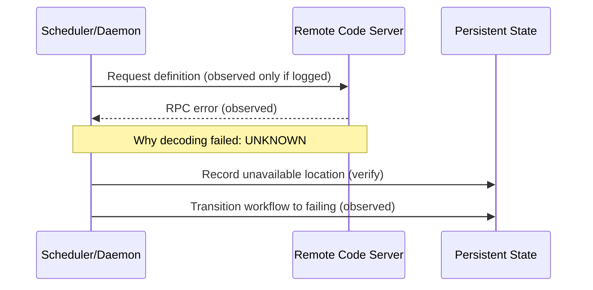
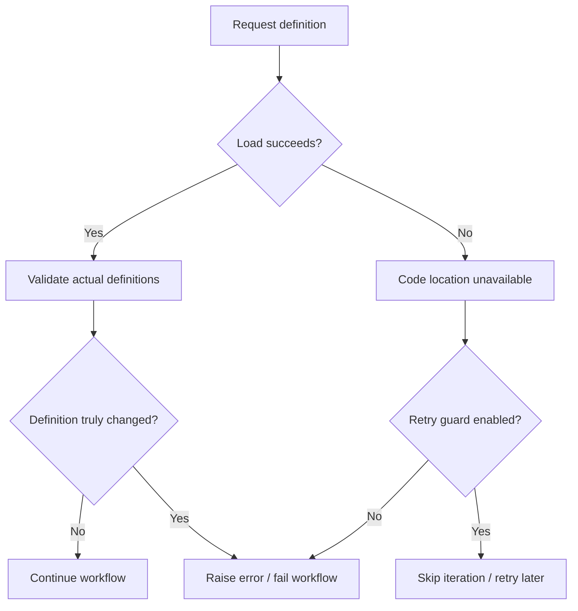

# Deep-investigate a system bug

Turn an existing bug record into a **causal explanation supported by code, observations, and reproducible tests**. Work from the incident's observable outcome back to the initiating event, then forward through the system to verify every propagation step. A symptom can have multiple independent causes; do not collapse them into one "root cause."

This skill complements `locate-system-problem`:

| Skill | Main question | Deliverable |
| --- | --- | --- |
| `locate-system-problem` | Where is the failure and which logic is implicated? | Initial `BUG-NNN` record |
| `deep-investigate-system-bug` | Why did it happen, why did it propagate, and how can we prove it? | Layered investigation, probes, reproducer, evidence ledger, and test plan |

## Input and operating rules

Start with the supplied `BUG-NNN`, issue URL, or symptom. If no bug record exists, first follow `locate-system-problem` rather than inventing a record or ID. Read repository agent instructions, the bug report, linked evidence, service boundaries, deployed versions, configuration, recent diffs, and existing tests. Distinguish **incident-time deployed code** from the current worktree.

- **Read first, mutate later:** inspect code, logs, metrics, traces, and persisted state using read-only commands. Do not restart services, alter deployments, rerun expensive jobs, cancel queued work, or inject faults into production.
- Run destructive, fault-injection, concurrency, network, or resource-stress experiments **only in an isolated staging/test environment** with explicit authorization. Specify rollback and cleanup.
- Minimize sensitive data in reports; redact credentials, tokens, PII, and internal connection strings.
- Do not silently modify the source bug record. Add a linked investigation companion unless the maintainer expressly wants an update.
- Preserve all pre-existing worktree changes. Don't fabricate logs, timings, links, stack traces, test results, or upstream guarantees.

## 1. Establish the incident boundary

Write a compact fact sheet:

| Item | Value |
| --- | --- |
| User-visible failure | Exact symptom and impact |
| First known good state | Timestamp + evidence |
| First known bad state | Timestamp + evidence |
| Impact and blast radius | Runs, records, requests, users, cost |
| Relevant components | Process, service, host, network, storage |
| Environment | Deployment, versions, configs, flags |
| Evidence gaps | Missing logs, metrics, payloads, traces |

Normalize all timestamps to UTC, retain original timezone, and annotate clock uncertainty. Separate **trigger time**, **detection time**, **failure-handling time**, and **terminal-status time**. Preserve exact exception types and request or trace identifiers. Do not infer the triggering component from the component that ultimately reported the error.

## 2. Decompose the incident into causal layers

Create a **layer map** in which each layer has its own question, evidence, hypotheses, and independent repro target. Useful layers vary by system; choose only those relevant:

1. **Trigger / lifecycle:** Why was this operation invoked then (tick, reload, scheduler, retry, TTL, event, user request)?
2. **Boundary / protocol:** What crossed a process/service boundary (RPC method, message type, payload, timeout, compression, auth)?
3. **Execution / resource:** What happened on the sender and receiver (exceptions, threads, memory, CPU, queueing, partial state)?
4. **State / interpretation:** How was failed or missing information represented (unavailable vs deleted, stale vs absent, transient vs permanent)?
5. **Recovery / policy:** What decided retry, fail, cancel, restart, checkpoint, or compensation?
6. **Impact / persistence:** Which durable states or side effects changed and can they be safely recovered?

**Do not infer that a previous layer succeeded because a later layer emitted a message.** For example, an RPC deserialization exception identifies a decoding boundary but not necessarily which party corrupted data.

Produce an incident-specific **Mermaid sequence diagram** to show calls and observed events, with `Note` annotations for unknowns. Produce a **Mermaid flowchart** for the error-handling branch. Use standard Mermaid syntax so diagrams render in GitHub Markdown. Mark unobserved edges `Hypothesis` and observed edges `Observed`; diagrams must not visually promote guesses to facts.

## 3. Build a proof ledger for every causal edge

An end-to-end explanation is only as strong as its weakest causal edge. Maintain this table:

| ID | From → To | Classification | Supporting evidence | Alternative explanation | Discriminating test | Result |
| --- | --- | --- | --- | --- | --- | --- |
| E1 | Trigger → RPC | Observed / Proven / Hypothesis | Log line, stack, code path | Other caller | Trace call site | Unrun |

Definitions:

- **Observed:** directly measured/logged; does not by itself establish why.
- **Proven:** source/configuration and evidence **or a controlled test** establish the specific causal claim; state the scope of that proof.
- **Hypothesis:** consistent with evidence but has at least one plausible alternative.
- **Unrun probe:** exact proposed measurement/test, never presented as a result.
- **Rejected:** contradicted by decisive evidence; explain why that evidence discriminates.

Prefer original evidence artifacts: timestamps, log offsets, full exception chain, trace IDs, process identity, build SHA, and relevant configuration. Link files under `<service>/docs/testing-docs/bugs/evidence/` when appropriate. Never treat absence of logs as proof an event did not happen without verifying the logging coverage.

## 4. Generate competing hypotheses, then design discriminating tests

For **each unresolved layer**, create at least two plausible explanations where possible. Rank by explanatory power and observability, **not** by intuition alone.

| Hypothesis | Predicted observation if true | Observation that refutes it | Cheapest safe probe | Status |
| --- | --- | --- | --- | --- |
| H1 | ... | ... | ... | Unrun |

Select a test that **separates hypotheses**, not one that merely reproduces the symptom. Progress from lowest risk and cost to highest:

1. **Static trace:** pinned upstream/local source, call sites, protobuf/schema definitions, flags, and exception handlers.
2. **Retrospective evidence:** correlated logs, traces, metrics, event IDs, persisted records, version/deploy timeline.
3. **Read-only targeted probe:** inspect state, versions, config, snapshot sizes, health, connection statistics.
4. **Isolated unit test:** reproduce the exact branch using fakes or injected failures.
5. **Isolated integration test:** exercise the real client/server protocol and persistence boundary.
6. **Controlled fault injection or load experiment:** single-factor perturbation, bounded concurrency/duration, explicit stop thresholds, cleanup.

For each command/test provide: **where to run**, permissions, production-safety label, prerequisites, expected output for H1 vs H2, artifact path, and interpretation. Never claim that a successful test proves the original trigger if it only proves the recovery path.

## 5. Trace code-level control and data flow

For each layer, locate the exact functions, call chains, and state transitions using pinned code and actual deployment configuration:

```text
entrypoint → caller → boundary → decoder/handler → exception mapping
           → state update → retry/cancel policy → persisted effect
```

Record `file:line` and commit/version where available. Verify implicit assumptions: error caught or propagated? retry budget? backoff? idempotency? partial success? state persistence? missing definitions vs unavailable definitions? lifecycle reloads? concurrency? package compatibility? transport errors vs application payload errors?

If upstream libraries are implicated, use the **exact installed version/tag**; check later versions separately and label any claimed fix as *verified*, *candidate*, or *unknown*. Avoid reasoning from current `main` about historical behavior.

## 6. Reproduce each layer independently and end-to-end

Define **two distinct types of repro**:

- **Mechanism repro:** deterministically forces a single suspected code path (e.g. injected unloadable location) and checks state transitions. It proves behavior under that condition, **not** what originally caused the condition.
- **Original-trigger repro:** produces the initiating failure through real interfaces (e.g. malformed RPC payload, server exception, concurrency race) and identifies the condition that makes it occur.

If practical, add an **end-to-end repro** linking both. Do not make an end-to-end repro a prerequisite for reporting a well-proven recovery bug.

A reproducible test must specify initial state, injected event, expected intermediate states, final state, cleanup, and negative/control cases. Test success paths, real deletion/configuration changes, temporary unavailability, repeated failure, timeout, and recovery when relevant. Assertions should check **durable outcomes**, not only emitted errors.

Provide either executable tests (when authorized) or precise unrun test pseudocode; never mark hypothetical tests as passing. Keep test data synthetic and bounded. Document any flakiness and repetition count.

## 7. Determine causality and decide what remains unknown

Use a finding summary for each layer:

| Layer | Finding | Confidence | Evidence IDs | Missing proof |
| --- | --- | --- | --- | --- |
| Trigger | ... | Proven / Likely / Unknown | E1 | ... |

Then explicitly answer:

- What is the **initiating failure**? Is its root cause verified?
- What is the **amplification mechanism** (where recoverable became terminal)?
- Which behavior belongs to **application code**, **configuration/deployment**, **upstream dependency**, or **infrastructure**? A trigger and an amplification mechanism may have different owners.
- Which protections would limit blast radius **without pretending to solve the trigger**?
- Which experiments remain necessary before claiming the original root cause?

**Stop** when each causal edge is proven or explicitly marked unknown with the cheapest next discriminating probe. Stop experimenting if tests threaten real data, produce uncontrolled resource usage, or no longer distinguish competing causes. A bounded, honest partial conclusion is better than speculative certainty.

## 8. Write the investigation artifact

Create:

`<service>/docs/testing-docs/bugs/BUG-NNN-investigation.md`

Use the existing service conventions. Link back to `BUG-NNN-*.md`; do not replace its template with a new schema. Include:

1. **Executive finding:** verified mechanism, unresolved trigger, severity/impact, evidence limits.
2. **Incident timeline:** precise UTC times, source for each observation.
3. **Component boundaries:** hosts/processes, network and storage interactions.
4. **Layer matrix:** trigger, protocol, execution, interpretation, recovery, impact.
5. **Mermaid sequence diagram:** timestamped calls and error propagation.
6. **Mermaid branch flowchart:** conditions that choose retry/failure/cancellation.
7. **Proof ledger and competing hypotheses:** observed/proven/hypothesis/unrun/rejected.
8. **Investigation commands and results:** environment, safety, expected vs actual; full raw output in evidence files.
9. **Reproduction tests:** mechanism, original trigger, end-to-end (if possible), controls, cleanup.
10. **Conclusions by ownership:** upstream, local application, configuration, infrastructure, and unanswered questions.
11. **Next probes ordered by information gain:** named files/functions, command or test, success/failure interpretation.
12. **Regression acceptance criteria:** what would verify a future fix; do not implement unless asked.

### Mermaid templates (adapt to actual evidence)





The diagrams are illustrative; confirm specific conditions against the deployed version before presenting them as incident facts.

## Completion checklist

- [ ] Exact incident-time code version/config and timeline documented.
- [ ] Trigger, protocol failure, propagation, recovery, and impact are separately analyzed.
- [ ] Every claimed causal edge has evidence and an explicit classification.
- [ ] At least one alternative is tested or remains explicitly open for each unresolved layer.
- [ ] Original-trigger and mechanism repro are not conflated.
- [ ] Tests identify initial state, assertions, controls, cleanup, and production-safety level.
- [ ] Mermaid diagrams reflect evidence and label uncertainty.
- [ ] Report links to raw artifacts, source locations, and the existing BUG record.
- [ ] No fix, deployment mutation, or production fault injection occurred without authorization.
