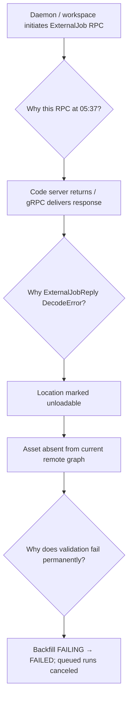
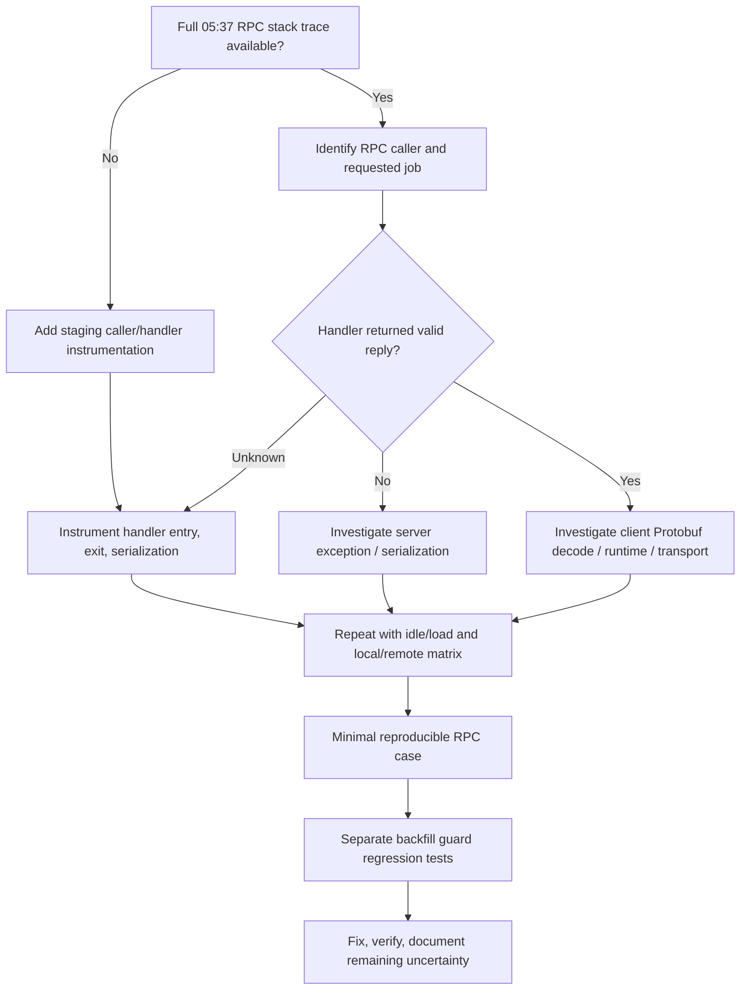

# BUG-014 — Dagster Backfill / gRPC Root-Cause Investigation

**Incident:** 2026-10-22 (UTC) · **Dagster:** 1.13.15 · **Backfill:** `srchztzv` · **Code location:** `ichin-etl`  
**Topology:** EC2 control plane (daemon/webserver/PostgreSQL) ↔ Tailscale ↔ remote Docker gRPC code server.  
**Impact:** 735 targeted partitions; 76 successful runs, 659 canceled. Verify run-to-partition mapping before treating these as unique partition counts.

## 0. Investigation model

Three related failures must be investigated **independently**. Proving the third does not establish the root cause of the second.



| Layer | Question | Current confidence | Exit criterion |
|---|---|---|---|
| 1. Trigger | Who requested `ExternalJob` at 05:37 and why? | Unproven | Caller, requested job, and cause of workspace reload identified |
| 2. RPC decoding | Why did `api.ExternalJobReply` fail Protobuf parsing? | Unproven | Same failure reproduced or request/response failure location identified |
| 3. Backfill recovery | Why did an unloadable location lead to terminal failure? | Strong evidence from logs and 1.13.15 source | Controlled failing/passing regression test |

**Timing:** Backfill began **03:49:43**; decode error **05:37:04–06** (~1 h 47 min after start); final `FAILED` at **05:43:46** (~1 h 54 min after start). The backfill is a series of daemon iterations and runs—not one uninterrupted RPC or one Python job.

## 1. Rules before touching the environment

- **Production-safe:** collect logs, inspect source/version/configuration, inspect container stats, query persisted backfill state, check historical deploy events.
- **Staging only:** kill/restart code servers, manipulate RPCs, saturate host, simulate missing asset definitions, toggle failure paths, add high-volume probes.
- Preserve all evidence in **UTC**, including host clock offsets. Avoid logging raw RPC payloads (may contain configuration details or secrets).
- Capture evidence **before** restarting containers, rotating logs, redeploying, or re-running the canceled partitions.
- Do not assume a `DecodeError` proves packet corruption or that lack of a container restart proves the code server was healthy.
- Do not confuse **659 canceled runs** with **659 distinct unmaterialized partitions** without checking run tags and materialization records.

## 2. Collect a reproducible evidence bundle (production-safe)

Run on the appropriate host. Replace container names if different. Do not paste potentially sensitive raw environment values into public issues.

```bash
export DAEMON=etl-poc-control-dagster-daemon-1
export WEBSERVER=etl-poc-control-dagster-webserver-1
export CODESERVER=etl-poc-execution-dagster-code-server-1
export SINCE=2026-10-22T05:30:00Z
export UNTIL=2026-10-22T05:50:00Z
mkdir -p evidence/BUG-014

# On EC2:
docker logs --timestamps --since "$SINCE" --until "$UNTIL" "$DAEMON" \
  > evidence/BUG-014/daemon.log 2>&1
docker logs --timestamps --since "$SINCE" --until "$UNTIL" "$WEBSERVER" \
  > evidence/BUG-014/webserver.log 2>&1
docker inspect "$DAEMON" --format \
  '{{json .State}}' > evidence/BUG-014/daemon-state.json
docker exec "$DAEMON" python -c \
  'import dagster,grpc,google.protobuf; print(dagster.__version__,grpc.__version__,google.protobuf.__version__)' \
  > evidence/BUG-014/daemon-versions.txt

# On execution host:
docker logs --timestamps --since "$SINCE" --until "$UNTIL" "$CODESERVER" \
  > evidence/BUG-014/code-server.log 2>&1
docker inspect "$CODESERVER" --format \
  '{{json .State}}' > evidence/BUG-014/code-server-state.json
docker exec "$CODESERVER" python -c \
  'import dagster,grpc,google.protobuf; print(dagster.__version__,grpc.__version__,google.protobuf.__version__)' \
  > evidence/BUG-014/code-server-versions.txt

# Both hosts:
date -u --iso-8601=seconds
uptime
```

**Log analysis:**

```bash
rg -n -C 15 'ExternalJobReply|DecodeError|deserializ|unloadable|ichin-etl|srchztzv|Backfill|DagsterAssetBackfillDataLoadError|grpc_status' \
  evidence/BUG-014/*.log
```

**Record:** first traceback (not just error summary), service/process that emitted it, gRPC method, status (`INTERNAL` vs others), request/job name if logged, exact timestamps, concurrent materializations, container state, and recent code/server deploys. `docker logs` cannot reconstruct metrics or payloads not captured at incident time.

## 3. Layer 1 — What triggered `ExternalJob` after 1 h 47 min?

`ExternalJob` fetches a **job definition/snapshot**; it is not a materialization result. A running backfill may involve repeated daemon/workspace activity. **Do not claim a specific periodic reload triggered this request until you identify the caller.**

### 3.1 Inspect the installed source, not current `master`

```bash
# On a host running Dagster 1.13.15:
docker exec -i "$DAEMON" python - <<'PY'
import inspect
from dagster._core.execution import asset_backfill
print(inspect.getfile(asset_backfill))
print(inspect.getsource(asset_backfill._check_validity_of_asset_backfill_data_and_should_process_backfill))
PY
```

> `-i` is required here because the Python script is supplied via standard input.

On a cloned source tree pinned to **v1.13.15** (do not compare with `master`):

```bash
git checkout 1.13.15   # Use a throwaway checkout/worktree, not your application repo
rg -n 'def ExternalJob\(|ExternalJobReply|\.external_job\(|\.get_external_job\(|external_job\(' \
  python_modules/dagster/dagster
rg -n 'create_request_context|reload_workspace|load_workspace|asset_backfill' \
  python_modules/dagster/dagster/_daemon python_modules/dagster/dagster/_core/workspace
```

Trace **caller → workspace context → gRPC client → `ExternalJob` server handler**. Look for a startup/reload/snapshot request, run submission, repository caching, and timeout/retry logic. Function names may differ; read the checked-out version.

### 3.2 Correlate the exact request

Inspect `05:36:45–05:37:20 UTC` across daemon and code-server logs. Determine:

1. Was there a new workspace load or repository reload at 05:37?
2. Which job/repository was requested? Was it the same snapshot as earlier successful loads?
3. Was the request concurrent with a materialization, run launch, asset evaluation, or daemon tick?
4. Did the server process handle `ExternalJob`, or did failure occur before handler entry?
5. Did any deployment, configuration refresh, connection reconnect, or database outage occur?

**Decision:** A stack trace naming the caller establishes the *trigger*. Temporal proximity to a backfill tick alone does not.

## 4. Layer 2 — Why did Protobuf decoding fail?

Dagster's `ExternalJobReply` carries serialized job data/errors inside a **Protobuf envelope**. `google.protobuf.message.DecodeError` for `api.ExternalJobReply` indicates failure parsing that *outer* envelope; it does **not** by itself prove the job snapshot's JSON failed to deserialize.

### 4.1 Establish the failure boundary

| Finding | Most useful next check |
|---|---|
| Server handler throws before returning | Server traceback, job snapshot construction, serializing error response |
| Server handler returns normally, client parsing fails | Generated gRPC stub/deserializer, response bytes size and framing, runtime version |
| Only one job fails repeatedly | Compare its job snapshot and response size against other jobs |
| Many unrelated jobs fail under concurrent load | gRPC threading/resources, process logs, socket health |
| Only cross-host requests fail, local loopback passes | Transport/proxy/Tailscale path; distinguish transport errors from parsing errors |
| No request identified | Improve instrumentation in staging before choosing a theory |

### 4.2 Check known confounders

```bash
# On both hosts; avoid exposing secrets from docker inspect or environment dumps.
docker exec "$CODESERVER" python -c \
 'import dagster,grpc,google.protobuf; print(dagster.__version__,grpc.__version__,google.protobuf.__version__)'
docker inspect "$CODESERVER" --format \
 'restarts={{.RestartCount}} oom={{.State.OOMKilled}} started={{.State.StartedAt}}'
docker stats --no-stream "$CODESERVER"
```

Check daemon/code server versions, gRPC/protobuf versions, service image digests, exact request size, gRPC limits, compression configuration, server errors, host OOM/CPU, disk pressure, and network path. **Current** `docker stats` cannot establish historical resource conditions.

### 4.3 Reproduce under staging conditions (controlled)

Build a small probe using Dagster **1.13.15's public or installed internal gRPC client API**. First inspect the exact signatures in the pinned version. Avoid inventing `ExternalJob` request fields; derive a valid request from a successful Dagster client trace or 1.13.15 tests.

- Repeatedly fetch all job definitions at low concurrency; record timestamp, requested job, latency, status, and response size.
- Repeat with runs/materializations active; then vary concurrency (e.g., 1 → 4 clients).
- Compare **local-to-code-server** versus **EC2-to-code-server** requests with the same job selection.
- Test large/complex jobs versus small ones. If safe, narrow to a single reliably failing job.
- If instrumentation is needed, instrument gRPC **handler entry/exit and response serialization separately**. Log length/hash/latency only; do not publish raw payloads.

Example of the metric shape to save:

```csv
utc,origin,job_name,concurrency,elapsed_ms,response_bytes,grpc_status,exception
2026-10-22T00:00:00Z,ec2,example_job,1,142,123456,OK,
```

A `DecodeError` that happens only for one response/job suggests a data- or serialization-specific defect. A failure independent of job under concurrent load suggests runtime or resource interactions. These are prioritization clues, **not proof**.

### 4.4 Add logging only after confirming support in installed version

In the exact 1.13.15 source, inspect any support for `DAGSTER_CODE_SERVER_LOG_EXCEPTIONS` and relevant gRPC tracing knobs before enabling them. Deploy bounded, redactable logs in staging; additional logging cannot recover the malformed bytes from the historical incident.

## 5. Layer 3 — Why did one RPC error permanently fail the backfill?

The key validation path in `dagster/_core/execution/asset_backfill.py` checks persisted target assets against the **currently loaded** remote asset graph. A failed code location can make an existing asset temporarily absent.

In 1.13.15, `_check_validity_of_asset_backfill_data_and_should_process_backfill` contains a guard resembling:

```python
if os.environ.get("DAGSTER_BACKFILL_RETRY_DEFINITION_CHANGED_ERROR") and unloadable_locations:
    return False  # skip this iteration
# otherwise: raise DagsterAssetBackfillDataLoadError(...)
```

**Confirm against the pinned source** and distinguish (a) backfill missing-asset validation from (b) later run cancellation. The guard is broad: an unloadable location plus a missing target can trigger skip, even if the missing target is in another location; a safer upstream fix should reason about ownership and actual definition changes.

### 5.1 Verify deployed configuration (production-safe)

```bash
docker exec "$DAEMON" sh -lc \
 'if [ "${DAGSTER_BACKFILL_RETRY_DEFINITION_CHANGED_ERROR:-}" = "1" ]; then echo ENABLED; else echo UNSET_OR_DIFFERENT; fi'
```

### 5.2 Prove behavior with a minimal regression test (staging)

Create an isolated test around the **installed version's actual function signature**; use Dagster's existing fixture/test helpers from v1.13.15:

```text
Given: persisted backfill targets bronze/ichin_website_salepage
And: the remote asset graph temporarily excludes that asset
And: workspace reports ichin-etl unloadable
When: a backfill validation iteration runs

Case A: flag unset
  Expected in observed v1.13.15 behavior:
  DagsterAssetBackfillDataLoadError → failure handling

Case B: flag = 1
  Expected: validation returns False; backfill iteration skipped

Case C: location recovered, asset present
  Expected: validation succeeds and backfill progresses

Case D: location fully loaded, asset genuinely removed
  Expected: validation raises definition-change error
```

Also verify the **real backfill status** and pending-run state after each case. A unit-level return value alone does not prove the full daemon lifecycle handles queued runs safely.

### 5.3 Production mitigation

Only after confirming the exact image/source semantics, add to the **daemon** (not only code server):

```yaml
services:
  dagster-daemon:
    environment:
      DAGSTER_BACKFILL_RETRY_DEFINITION_CHANGED_ERROR: "1"
```

This protects against the identified definition-validation failure path. It does **not** repair `ExternalJobReply` deserialization and may delay detection of real definition changes while *any* location remains unloadable. Add alerts for prolonged unloadability/backfill non-progress.

## 6. Decision tree



## 7. Evidence standard and deliverables

Do not promote a hypothesis into a conclusion without the corresponding proof.

| Claim | Minimum proof |
|---|---|
| Reload caused `ExternalJob` request | Caller stack/instrumented trace links both events |
| Network caused corruption | Captured or instrumented evidence localizing malformed bytes/framing to transport; normal gRPC status alone is insufficient |
| Job definition causes failure | Reproducible failure isolated to same definition and input |
| Thread contention causes failure | Controlled concurrency experiment with repeatable rate difference and relevant traces |
| Backfill has unsafe default handling | Pinned source + unit/integration test reproducing fail vs skip behavior |
| Fix works | Same repro fails before change and passes after change, including genuine-deletion test |

Save an `evidence/BUG-014/README.md` with timestamp range, commit/image digests, exact commands, source line references, retained/redacted logs, test results, alternative hypotheses, and remaining unknowns.

### Suggested issue split

1. **Backfill resilience (actionable now):** transient unloadable code location leads to terminal failure by default; include logs, source guard, and regression test.
2. **ExternalJobReply decoding (needs more evidence):** sporadic Protobuf `DecodeError`; open separately if reproducible, or attach a precise stack trace and staging probe results to the backfill issue.

### Source references

- [Dagster asset-backfill validation source](https://github.com/dagster-io/dagster/blob/1.13.15/python_modules/dagster/dagster/_core/execution/asset_backfill.py)
- [Dagster gRPC server source](https://github.com/dagster-io/dagster/blob/1.13.15/python_modules/dagster/dagster/_grpc/server.py)
- [Dagster code-location documentation](https://docs.dagster.io/deployment/code-locations)
- [Related Dagster issue #29467](https://github.com/dagster-io/dagster/issues/29467)

**Stop condition:** investigation is complete when the original RPC failure has a reproducible cause **or a clearly documented unresolved boundary**, and the backfill-resilience failure has a reproducible test and validated mitigation/fix. Do not declare full root cause solely because the retry flag avoids cancellation.
